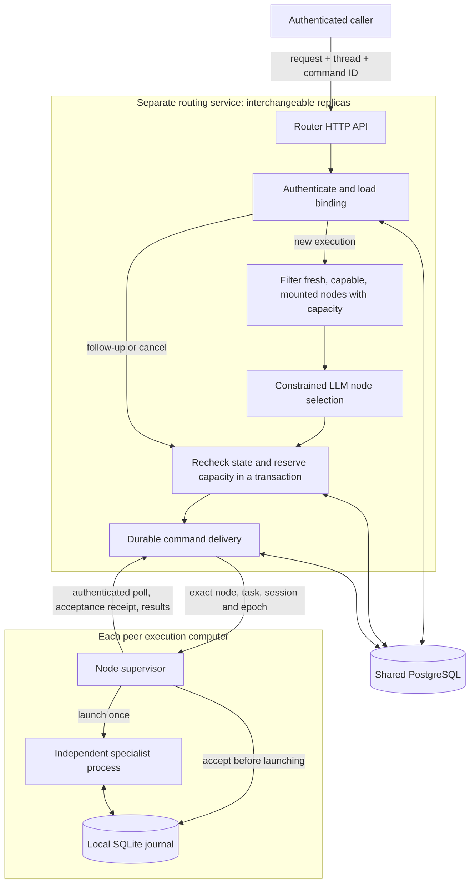
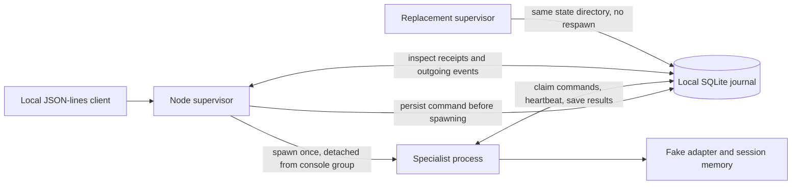
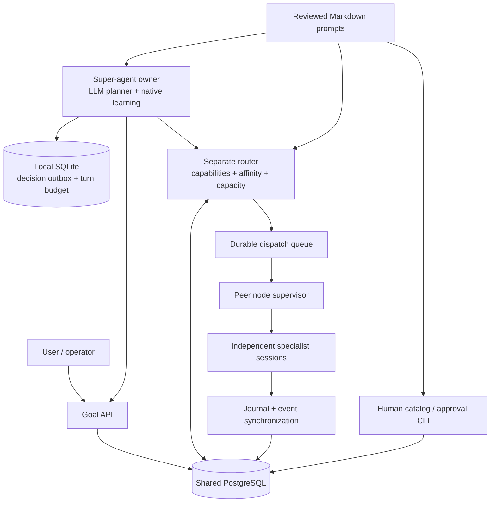

# Cuttlefish

<p align="center"></p>

A Rust framework for coordinating agents across a group's computers.

[Architecture lessons from Octop](docs/octop-lessons.md) · [Logo and brand assets](assets/brand/README.md) · [Editable prompts](prompts/README.md)

The project lives in `~/Projects/cuttlefish`. Existing `orchestrator-*` crate and
command names remain stable for compatibility with current scripts and journals.

**Implemented: milestones 1–4 and the first super-agent collaboration increment.** This repository contains the shared protocol,
pure task lifecycle, asynchronous adapter contract, and a node runtime with a
SQLite journal and supervised specialist processes. Each specialist currently
runs the deterministic fake adapter. A separate coordination service authenticates
nodes and stores shared routing context in PostgreSQL. It has no execution powers.
It now makes constrained LLM routing decisions and delivers tasks with durable
thread/session affinity and conservative failover. Real coding providers and a
web interface remain future work. The node can now plan goals, delegate child tasks,
track progress, and propose catalog-backed learning with human approval.
See [Super-agent collaboration](#super-agent-collaboration) and the
[editable prompt library](prompts/README.md).

The first Octop-review improvement adds [durable runtime permissions and provider
session bindings](docs/runtime-permissions.md): exact human approvals, local
reviewer credentials, conservative reply delivery and restart recovery. This is
the adapter contract and local review surface; the production worker still uses
the fake adapter. A real provider, remote review UI and permission synchronization
to the router are subsequent integrations.

## Workspace

| Crate | Responsibility | Dependencies inside the workspace |
| --- | --- | --- |
| `orchestrator-protocol` | Typed IDs, validated values, versioned commands and events | None |
| `orchestrator-domain` | Pure task and goal transitions, delegation and learning policy | Protocol |
| `orchestrator-agents` | Async adapters, fake specialist, constrained goal planner | Protocol, prompts; domain in tests |
| `orchestrator-node` | Journal, supervision, goal loop and durable decision outbox | Protocol, domain, agents, prompts |
| `orchestrator-coordinator` | Shared collaboration records, catalog, routing, affinity and dispatch | Protocol, domain, prompts; execution crates only in tests |
| `orchestrator-prompts` | Bounded Markdown prompt loading and bundled defaults | None |

The workspace uses Rust 2024 and pins its compiler in `rust-toolchain.toml`.
`Cargo.lock` pins the resolved dependencies. There are no empty placeholder
crates. SQLite is bundled through SQLx; milestone 3 requires PostgreSQL.

## Run the checks

Install Rust through rustup. The first Cargo command installs the pinned toolchain
and its formatting, lint, and LLVM coverage components if they are missing.

```sh
# Use a dedicated PostgreSQL test database; the tests create isolated schemas.
createdb orchestrator_test
export COORDINATOR_TEST_DATABASE_URL=postgresql://localhost/orchestrator_test
cargo fmt --all -- --check
cargo clippy --workspace --all-targets --locked -- -D warnings
cargo test --workspace --all-targets --locked
cargo test --workspace --doc --locked
cargo doc --workspace --no-deps --locked
```

Install the coverage driver once:

```sh
cargo install cargo-llvm-cov --version 0.9.1 --locked
cargo coverage --locked
```

`cargo coverage` is an alias that fails below **100% line, function, or region
coverage** of instrumented workspace source. Only files under test directories are
excluded from the report; no production modules or error paths are excluded.
Dependencies and compiler-generated code are not a guarantee of this metric.
Stable LLVM region coverage is not branch coverage or proof of correctness.

To create a browsable report after running coverage:

```sh
cargo llvm-cov report --html --output-dir target/coverage --ignore-filename-regex /tests/
```

Open `target/coverage/html/index.html`. CI enforces the same coverage threshold,
checks docs, and tests the node and foundational crates on Linux, macOS, and
Windows. PostgreSQL integration and coordinator CLI tests run in the Linux
coverage job. Tests require a database account with schema creation privileges
and fail explicitly if the test database is not configured; they never silently
skip integration coverage. A configured CI matrix is not a claim that every
platform has already been run locally.

## Shared database boundary

The separate coordinator stores the group's durable records in **shared PostgreSQL**.
Multiple identical coordinator instances share that database. Computers use authenticated server
APIs; they do not receive database credentials or connect directly to PostgreSQL.
Each computer uses **its own SQLite journal** for command receipts and local
sessions. SQLite files are never shared or mounted between computers.

The supervisor and its specialist processes open the same local SQLite file with
independent connections. The node stores durable receipts and an outgoing event
queue; the fake adapter's conversation remains in its process memory. Supervisor
replacement preserves that process. Specialist termination does not preserve its
in-memory conversation, and does not authorize an automatic replacement.
Durable exactly-once external effects are not claimed.

## Separate routing and coordination service

All super agents remain peers. The coordinator is deployed like a load balancer,
and can have multiple interchangeable replicas. It stores context and handles
synchronization and task routing; it never imports the agent execution or node runtime
crates in production. PostgreSQL is the shared authority for membership, bindings,
dispatch receipts and received events.



Start a local PostgreSQL database and enroll a node using the operator CLI.
Provisioning and revocation require database credentials; nodes never receive them.
The group/node IDs must match the local runtime's existing journal.

```sh
createdb orchestrator
export DATABASE_URL=postgresql://localhost/orchestrator
mkdir -p .node
umask 077
openssl rand -hex 32 > .node/node.token
cargo run -p orchestrator-coordinator -- enroll \
  --group 00000000-0000-0000-0000-000000000001 \
  --node 00000000-0000-0000-0000-000000000002 \
  --token-file .node/node.token
cargo run -p orchestrator-coordinator -- serve --listen 127.0.0.1:8080
```

Keep the token file private. PostgreSQL stores only a SHA-256 hash of this random
256-bit bearer credential. Existing identities cannot be re-enrolled or moved
between groups. Use `revoke --group <group-id> --node <node-id>` to reject future
connections while preserving their history. Revocation waits for an already
authorized transaction to finish before taking effect.

Run the local node once as described below to create its journal. On each computer,
write `.node/profile.json` with its actual platform and configured capabilities:

```json
{"platform":"mac_os","capabilities":["code.rust","build.ios"],"capacity":4}
```

Supported platform spellings are `mac_os`, `windows`, and `linux`. Declared
capabilities describe routing suitability; they do not grant filesystem access.
Start a separate synchronization process alongside that computer's node runtime:

```sh
cargo run -p orchestrator-node -- sync --state-dir .node \
  --coordinator http://127.0.0.1:8080 \
  --token-file .node/node.token --profile-file .node/profile.json
```

It sends a heartbeat and up to four pending events every five seconds. Failed
requests are retried; Ctrl-C stops synchronization without stopping specialists.
Add `--once` to send one batch and exit, returning an error if synchronization
fails. For different computers, configure an HTTPS origin behind your TLS reverse
proxy. Plain HTTP is accepted only for literal loopback IP addresses, and redirects
are never followed. HTTP requests time out after ten seconds, so an in-flight
upload may delay watch-mode shutdown by that bound.

| API | Purpose |
| --- | --- |
| `POST /v1/sync` | Authenticate a node, update presence and capabilities, commit an event batch |
| `GET /v1/nodes` | Read up to 1,000 non-revoked peers in the caller's group |
| `GET /v1/events?after=0` | Read up to 100 group events ordered by server cursor |

Every endpoint requires `Authorization: Bearer <node-token>`. Group membership
comes from the credential, not a caller-selected URL. The report's group and node
must match it. Peer results do not expose token hashes, workspace registration paths, or
database credentials. Nodes are trusted members of their group and can read that
group's synchronized event content; fine-grained user/agent permissions are later
work. Events currently contain the command and outcome, including message text;
they are not a redacted activity summary.

The PostgreSQL migration adds `groups`, `nodes`, and `node_events`. A transaction
checks the current credential, validates the entire report, deduplicates immutable
events, and updates presence. Acknowledgments are sent only after commit. The node
checks that the acknowledgment exactly matches its batch before marking local
events delivered. If either process crashes between those steps, redelivery is
safe. A duplicate identity with different content fails, rather than rewriting
history. Uploads are at-least-once; stored events are deduplicated.

Writes are serialized per group so pagination cursors follow commit order;
different groups can write concurrently. A reader uses the last returned cursor
as its next `after` value. Node liveness uses server-observed timestamps; a profile
is not proof that the node is currently reachable. The original node identity and
SQLite journal must be retained together: do not delete a journal and reuse its
credentials, because local event sequences must never restart under one identity.

Event text is untrusted data, never router instructions. Token rotation, inventory
pagination beyond the initial 1,000 peers, and operator-facing health/metrics are
subsequent work.

## LLM routing and task delivery

Configure an explicit model that supports structured outputs. The model key stays
on the routing service and is read from a private file; it is never sent to nodes.
No model is selected implicitly. Without configuration, new execution selection
returns HTTP 502; existing thread affinity still works.

```sh
cargo run -p orchestrator-coordinator -- serve \
  --model YOUR_STRUCTURED_OUTPUT_MODEL --model-key-file /private/path/model.key
```

The adapter uses the [OpenAI Responses API structured-output contract](https://developers.openai.com/api/docs/guides/structured-outputs?api-mode=responses).
`--model-endpoint` defaults to `https://api.openai.com/v1/responses`; HTTPS endpoints
and literal-loopback HTTP test endpoints are supported. Calls have a 15-second
timeout, no tools, no redirects, `store: false`, and a strict schema enumerating
eligible node IDs. Responses are bounded to 256 KiB and incomplete, malformed,
refused or ineligible selections fail closed. The tests use controlled model
responses and do not make paid model calls.

After initializing the node and mounting its workspaces through the local
interface, exit that local supervisor. Start the execution-enabled supervisor:

```sh
cargo run -p orchestrator-node -- sync --execute --state-dir .node \
  --coordinator http://127.0.0.1:8080 \
  --token-file .node/node.token --profile-file .node/profile.json
```

`--execute` owns the same supervisor lock and preserves specialists across its
restart. Each cycle reconciles workers, uploads results, and polls for one command.
Cycles run once per second when requests finish quickly; failures retain local
state and are retried. `--once` performs a single cycle. Plain `sync` remains an
upload-only process and does not advertise execution readiness. Ctrl-C waits for
the current bounded cycle; the two HTTP calls may each take up to ten seconds.

| API | Purpose |
| --- | --- |
| `POST /v1/tasks` | Start, send, cancel, or explicitly restart a thread's specialist |
| `GET /v1/threads/{thread_id}` | Inspect its latest dispatch and known outcome |
| `POST /v1/threads/{thread_id}/failover` | Move an unclaimed start from an unavailable node |
| `POST /v1/dispatch/poll` | Node readiness, durable acceptance acknowledgments and one claimed command |

All four endpoints use the same group-scoped bearer authentication as synchronization.
For this trusted-peer MVP, a node credential can also submit tasks for its group.
Separate human identity and authorization roles remain future work.

Example body for `POST /v1/tasks` (use new UUIDs for new work):

```json
{
  "command_id": "00000000-0000-0000-0000-000000000100",
  "thread_id": "00000000-0000-0000-0000-000000000101",
  "action": {
    "type": "start",
    "task_id": "00000000-0000-0000-0000-000000000102",
    "session_id": "00000000-0000-0000-0000-000000000103",
    "workspace_id": "00000000-0000-0000-0000-000000000005",
    "capabilities": ["code.rust"],
    "message": {"id": "00000000-0000-0000-0000-000000000104", "text": "Build the feature"}
  }
}
```

For follow-ups retain `thread_id`, use fresh command and message IDs, and set
`action` to `{"type":"send","message":{"id":"<new UUID>","text":"Continue"}}`.
Cancellation uses `{"type":"cancel"}`. After a confirmed cancellation, an explicit
restart uses `{"type":"restart","session_id":"<new UUID>","message":{"id":"<new UUID>","text":"New execution"}}`.
Retry a lost response with the original **entire request and command ID**.
Reusing an ID with changed content returns HTTP 409.

Routing uses these rules:

- A new execution requires both a profile heartbeat and an execution poll within
  30 seconds, all requested capabilities, a registered workspace ID, and available
  session capacity. Up to 32 eligible nodes and eight recent activity excerpts
  (1,000 characters each) form the model context. Local directory paths stay local.
  Operators must provision equivalent files or shared storage themselves; matching
  workspace IDs do not synchronize files between computers.
- Follow-ups and cancellation use the exact saved node/task/session/epoch. They
  do not call the LLM. A stale owner does not silently redirect an existing session.
- Selection happens outside database transactions. Before committing, the router
  checks fresh eligibility, binding revision and capacity again under the group
  lock. Concurrent requests cannot reserve the same last slot.
- PostgreSQL marks a command **claimed before returning it**. Until the node
  acknowledges durable SQLite acceptance, it may receive the same command again.
  Acceptance receipts survive supervisor restart. Results commit before acknowledgment.
- Failover only moves a queued, unclaimed start whose owner is unavailable. It
  preserves the original request ID and increments the execution epoch. Claiming
  and failover serialize on the same group lock. A lost claim response therefore
  makes the work uncertain; it never authorizes execution on a second computer.
- A restart requires an authenticated cancellation result, a fresh session ID and
  an incremented epoch. An old cancellation replay cannot stop a newer session.

The MVP supports **one specialist task per thread and one outstanding command per
thread**. A command result completes that dispatch, not the long-lived session;
session capacity remains occupied until the specialist stops. HTTP 409 indicates
a lifecycle conflict or unsafe failover, 503 unavailable capacity/storage, and
502 unavailable model selection. The failover endpoint must be invoked by a caller;
there is no automatic background failover scheduler yet. Claimed work with an
unknown result blocks the thread and requires reconciliation; force cancellation
and recovery from a lost specialist are not implemented. Restart starts fresh and
does not reconstruct the previous specialist's in-memory conversation.

| Added durable data | Purpose |
| --- | --- |
| PostgreSQL `thread_bindings` | Owner, task/session/epoch, required workspace/capabilities, revision and confirmed stoppage |
| PostgreSQL `dispatches` | Original request, addressed command, queued/claimed/completed state, acceptance and known result |
| PostgreSQL `nodes.dispatch_*` | Execution readiness, mounted workspace IDs and occupied session count |
| SQLite `dispatch_receipts` | Durable delivery acknowledgments waiting for the router |

Migrations are additive `0002_dispatch.sql` files in both runtime crates. No Redis
or message broker is required. Router replicas share PostgreSQL; no authoritative
thread affinity or delivery state lives only in a router's memory.

## Local node runtime



Run from the repository root:

```sh
cargo run -p orchestrator-node -- run --state-dir .node \
  --group 00000000-0000-0000-0000-000000000001 \
  --node 00000000-0000-0000-0000-000000000002
```

The node prints a `ready` response, then accepts one JSON request per line. First
register the current directory as a workspace:

```json
{"type":"mount","mount":{"workspace_id":"00000000-0000-0000-0000-000000000005","path":"."}}
```

Start one fake specialist:

```json
{"type":"submit","command":{"version":1,"command_id":"00000000-0000-0000-0000-000000000006","group_id":"00000000-0000-0000-0000-000000000001","node_id":"00000000-0000-0000-0000-000000000002","target":{"task_id":"00000000-0000-0000-0000-000000000003","session_id":"00000000-0000-0000-0000-000000000004","execution_epoch":1},"action":{"type":"start","workspace_id":"00000000-0000-0000-0000-000000000005","message":{"id":"00000000-0000-0000-0000-000000000007","text":"Hello"}}}}
```

A `receipt` confirms durable acceptance, not completion. Inspect it with
`{"type":"command","command_id":"00000000-0000-0000-0000-000000000006"}`,
or read `{"type":"events"}` until the result appears. Acknowledge a delivered
event with `{"type":"acknowledge","sequence":1}` using its actual sequence.

`{"type":"shutdown"}` or EOF exits only the supervisor. Run the same command
again with the same state directory and identities, then send a follow-up:

```json
{"type":"submit","command":{"version":1,"command_id":"00000000-0000-0000-0000-000000000008","group_id":"00000000-0000-0000-0000-000000000001","node_id":"00000000-0000-0000-0000-000000000002","target":{"task_id":"00000000-0000-0000-0000-000000000003","session_id":"00000000-0000-0000-0000-000000000004","execution_epoch":1},"action":{"type":"send","message":{"id":"00000000-0000-0000-0000-000000000009","text":"Continue in the original process"}}}}
```

Inspect the original process identity with
`{"type":"session","session_id":"00000000-0000-0000-0000-000000000004"}`.
To request shutdown of all local specialists, use a separate terminal:

```sh
cargo run -p orchestrator-node -- stop --state-dir .node
```

Stop is cooperative: an active adapter operation finishes before the worker exits.
It does not terminate the supervisor. A session-specific `cancel` command uses
the same envelope with a fresh command ID and `"action":{"type":"cancel"}`.

### Journal and supervision guarantees

| Local table | Stored information |
| --- | --- |
| `node_identity` | Permanent group and node binding |
| `workspace_mounts` | Logical workspace IDs and canonical local directories |
| `local_sessions` | Task/session/epoch, launch instance, process ID, heartbeat, stop request |
| `command_receipts` | Original command, FIFO sequence, execution state, known outcome |
| `pending_events` | Results and delivery acknowledgments for eventual server synchronization |
| `dispatch_receipts` | Command acceptances waiting for coordinator acknowledgment |

The migration is `crates/node/migrations/0001_journal.sql`. SQLite uses WAL,
FULL synchronization, foreign keys, strict tables, and a five-second busy timeout.
Receipt and outgoing-event updates commit in one transaction. Event reads are
bounded to 100 entries; input frames are bounded to 1 MiB before JSON decoding.

One OS file lock permits one supervisor per state directory. A start command and
its launch identity commit before process creation. Redelivering an identical
command returns its saved receipt without spawning again. Reusing its ID with
changed content fails. A worker may register a launch identity only once.

Workers have independent process groups, journal connections, and per-session
stderr logs in the state directory. They do not inherit supervisor input/output
pipes and are not killed when the supervisor drops its handles. The supervisor
reaps children it still owns; after replacement it observes the original workers
through their journal heartbeats. Saved PIDs are informational, never kill targets.

Workers claim one FIFO command at a time. Heartbeats continue during a slow
adapter operation. A 30-second heartbeat expiry, failed launch, or unexpected
process exit marks unresolved work uncertain. Uncertain work is never replayed
automatically, and blocks subsequent claims in that session. The original worker
can still report the result of work it already claimed. A crash between committing
launch intent and spawning therefore requires reconciliation instead of a blind
retry. This deliberately favors avoiding duplicate effects over automatic recovery.

The real-process tests kill and replace the supervisor, verify the unchanged
specialist PID and launch identity, and successfully send follow-ups. They also
cover orderly replacement, duplicate worker rejection, and cooperative shutdown.
Storage tests inject statement and commit failures, check transaction rollback,
and race independent connections for command admission and claiming.

## Protocol rules

- Distinct UUID newtypes prevent exchanging group, node, task, session, and other
  IDs accidentally. Nil UUIDs are rejected, including during deserialization.
- Version 1 uses JSON with explicit `type` tags. Unknown versions, actions, and
  fields fail closed. This is a coordinated versioned contract, not a promise of
  forward compatibility with arbitrary extra fields.
- Message text is non-whitespace and at most 65,536 UTF-8 bytes. Accepted text is
  not trimmed or otherwise rewritten.
- Capability names match `[a-z][a-z0-9._-]{0,63}`; the OS does not imply a capability.
- Execution epochs start at 1, never wrap, and are independent of a supervisor's
  eventual ownership version. Protocol and domain code read no clocks or random
  sources. The node runtime generates launch identities and tracks heartbeats.
- The local runtime validates node identity, registered workspaces, byte limits,
  epochs, and ordering. The coordinator authenticates and scopes remote requests.
  A well-typed command alone is not authorization.

See `crates/protocol/tests/contracts.rs` for the golden JSON contract and boundary
tests. Compile-fail doctests also enforce nominal IDs and private value fields.

## Task lifecycle

`TaskState::transition` returns a new immutable state or a typed error. It does not
persist anything. Callers must validate the identity and epoch of ordinary
executor events before constructing domain actions.

| Current state | Accepted actions and results |
| --- | --- |
| Queued | Begin → running; fail → failed; cancel → cancelled |
| Running | Need input → waiting; complete → completed; fail → failed; disconnect → interrupted; cancel → cancelling |
| Waiting for input | Resume → running; fail → failed; disconnect → interrupted; cancel → cancelling |
| Cancelling | Confirm stop → cancelled; complete → completed; fail → failed; disconnect → interrupted |
| Interrupted | Reconcile same epoch → observed running/waiting/completed/failed/cancelled state; cancel → cancelling; safe explicit restart → queued |
| Failed or cancelled | Safe explicit restart → queued |
| Completed | No further actions in this milestone |

This pure domain model describes an adapter's business task lifecycle. The router
tracks delivery separately using queued/claimed/completed receipts and persistent
session bindings. A completed dispatch can leave a specialist ready for follow-up.

Cancellation after dispatch is a request, not immediate proof of stoppage.
Reconciliation preserves the execution epoch and explicitly rejects mismatched
epochs. Restart requires a resolved previous execution and increments the epoch.
The recovery service must establish that evidence; an enum value is not proof.

The exhaustive test table checks all eight states against fifteen action cases,
including each possible recovery observation and safe/unsafe restart. Additional
tests check epoch exhaustion, long follow-up sequences, and cancellation races.

## Fake specialist

`Agent` is a small async trait with a `Send` future and an adapter-specific associated
error type. It uses static dispatch, without requiring an async runtime in the
production library. Tokio is only a test dependency. Real adapters can provide
their own errors without extending an enum owned by the fake.

`FakeAgent` echoes validated inputs and retains their order in a session. It:

- binds to one group and computer;
- starts sessions in a logical workspace and accepts follow-ups;
- verifies task identity and exact execution epoch;
- returns the saved result for an identical successful command retry;
- rejects command-ID reuse with different content;
- rejects a repeated message ID submitted under another command;
- confirms cancellation and rejects new messages afterward;
- injects a deterministic failure before committing the next valid new command.

Invalid commands and successful-command replays do not consume an injected failure.
Rejected commands do not store successful receipts. A replay may return a historical
result after cancellation, but cannot reopen or mutate that session.

The fake stages a session copy before committing it. This keeps failure behavior
atomic for tests; it is not intended as a scalable persistence implementation.
Session histories and receipts are unbounded in this test adapter. Admission
limits and durable retention will be runtime/server responsibilities.

## Design discipline

Business rules depend on typed contracts, not HTTP, SQL, or a vendor SDK. Public
types are documented, fallible operations return typed errors, and invalid scalar
values are rejected at construction and decoding. Unsafe code is forbidden.
Clippy's standard and pedantic groups are errors, as are production uses of
`unwrap`, `expect`, and `panic!`. Test fixtures explicitly allow `expect`.

## Remaining milestones

The local interface trusts the operating-system user. Workspace registration
selects a working directory; it is not filesystem isolation. Do not expose this
stdio interface directly as an unauthenticated network service.

Next: real coding adapters, richer super-agent delegation, human authentication,
operator reconciliation, bounded retention, resource isolation, automatic
service startup, process-tree shutdown, and recovery after the specialist itself
dies remain separate work. Force cancellation of an active adapter operation is
not implemented. An async adapter must yield to Tokio; blocking subprocess waits
or CPU work need an appropriate asynchronous or blocking-task boundary.

## Super-agent collaboration

Every node can own goals and delegate to eligible peer nodes. Goal ownership is
per goal; there is no privileged global execution agent. The separate router
stores shared coordination records and chooses execution nodes. Only node
processes execute specialists. The current specialist is still the fake adapter.



### State and authority

- **Goals:** objective, acceptance criteria, owner, revision and active/paused/completed state.
- **Plans:** up to 64 child tasks with stable task, thread, command and session IDs,
  acceptance criteria and an acyclic dependency graph. Tasks are append-only.
- **Delegation:** the owner reserves a ready task before routing it. Dependencies
  must have verified results. Router context includes goal ownership, executing
  node, specialist session, state and a bounded progress summary.
- **Progress and discussion:** the assigned executor reports fixed-total,
  monotonic progress; participants can discuss work. Successful execution and
  owner verification are separate. Every task must be verified before completion.
- **Learning:** `agent.learn`, `agent.plan` and `agent.delegate` are native
  capabilities advertised by the super-agent loop. The planner first considers
  peers, then the organization catalog. It can propose a specific release for a
  node or propose replication of an active release to named peers.
- **Approval:** each `(goal, release, node)` needs human approval before setup,
  recorded evaluation evidence, and human activation. Replication creates new
  pending proposals. Node credentials cannot call an approval endpoint; there
  is none. An operator uses the separate CLI with database credentials.
- **Reuse:** activated releases and evidence are recorded in a group-scoped
  installation registry and included in planning context across goals. This
  registry does not itself install a tool or advertise a working executor.

PostgreSQL owns `goals`, `goal_tasks`, idempotent `goal_commands`, immutable
`capability_releases` and per-node `node_capabilities`. The existing dispatch and
node event tables remain the authority for execution. SQLite owns the local
`super_agent_outbox` and `planning_budget`, alongside specialist state.
Agents communicate with the shared database through authenticated APIs; they
are not given PostgreSQL credentials.

Each decision carries a command UUID and expected goal revision. The node saves
it before sending it. Lost responses are retried with the same UUID and return
the original receipt; a definitive conflict clears the pending decision for
replanning. Goal updates, task links and receipts commit atomically. Restarting
the supervisor preserves the planning budget and does not terminate specialists.
Existing conservative execution failover rules still apply. This increment does
not transfer goal ownership automatically when its owner is unavailable.

### Added endpoints

All requests below use the existing node bearer token and its group scope.

| Method | Endpoint | Purpose |
| --- | --- | --- |
| POST | `/v1/goals` | Create a goal idempotently; caller becomes owner |
| GET | `/v1/goals` | Up to 100 current goal snapshots |
| GET | `/v1/goals/{goal}` | Goal with current child execution receipts |
| POST | `/v1/goals/{goal}/commands` | Revision-checked plan, delegate, progress, discuss, verify, pause/resume, finish, learn, evaluate or replicate |
| POST | `/v1/goals/{goal}/tasks/{task}/dispatch` | Route a reserved child task using existing dispatch rules |
| GET | `/v1/capabilities` | Up to 1,000 immutable catalog releases |
| GET | `/v1/capabilities/installations` | Up to 1,000 active, non-revoked node installations |

These list limits are MVP bounds, not pagination. Full goal and command shapes
are documented in `crates/protocol/src/collaboration.rs`. The API currently uses
node credentials; a user-facing authentication layer and UI remain future work.

Example goal creation body:

```json
{
  "goal_id": "00000000-0000-0000-0000-000000000100",
  "thread_id": "00000000-0000-0000-0000-000000000101",
  "objective": "Prepare and review the requested deliverables",
  "acceptance": "Each deliverable has evidence satisfying its acceptance criteria"
}
```

### Running a super agent

Initialize the node, enroll it and mount approved workspaces using the earlier
instructions. Create the goal with that node's token. Configure an explicit model
and an absolute path to its key file in `super-agent.json`:

```json
{
  "goal_id": "00000000-0000-0000-0000-000000000100",
  "endpoint": "https://api.openai.com/v1/responses",
  "model": "YOUR_CONFIGURED_MODEL",
  "key_file": "/absolute/private/path/model.key",
  "turn_limit": 100,
  "prompt_dir": "/absolute/path/to/cuttlefish/prompts"
}
```

```sh
cargo run -p orchestrator-node -- sync \
  --state-dir ./node-state \
  --coordinator http://127.0.0.1:8080 \
  --token-file ./node.token --profile-file ./profile.json \
  --execute --super-agent ./super-agent.json
```

Add `--once` for a single coordination step. Otherwise the loop runs every five
seconds, synchronizes events, resumes any pending decision, dispatches reserved
work and requests at most one new model decision. Every model attempt, including
failure or a wait decision, consumes a durable turn. Increase `turn_limit`
explicitly to extend a goal's budget. Errors stop the loop for inspection; restart
it to resume. Planning receives only logical workspace IDs, not local paths.
The router still checks destination mounts, current capacity and capabilities.

### Publishing and approving a capability

Author Markdown under `prompts/capabilities/<name>/` and reference it from a
manifest, following the example in that folder. Review the exact files before
publishing. New harness revisions need new release UUIDs and can name a prior
release in `supersedes`; publication cannot mutate an existing release.

```sh
cargo run -p orchestrator-coordinator -- catalog \
  --group "$GROUP_ID" --file ./prompts/capabilities/my-capability/manifest.json
```

The operator CLI uses `DATABASE_URL`. It is intentionally separate from node
HTTP authorization. For an existing learning proposal, put `{"type":"approve"}`
in a decision JSON file and review the current goal revision:

```sh
cargo run -p orchestrator-coordinator -- learning \
  --group "$GROUP_ID" --goal "$GOAL_ID" --node "$NODE_ID" \
  --release "$RELEASE_ID" --revision "$GOAL_REVISION" \
  --decision-file ./approval.json
```

After actual setup and testing, the target node can submit an `evaluate` goal
command with `release_id`, `passed` and evidence. The LLM planner is explicitly
prohibited from generating this operation. The human then reviews the evidence
and submits `{"type":"activate"}` at the new goal revision. A rejection or
revocation uses `{"type":"reject","reason":"explanation"}`. Revocation updates
the installation registry; it does not uninstall software or cancel running work.

### Scope of this increment

Implemented learning is discovery, proposals, approval, evidence recording,
versioning and reuse tracking. Actual third-party download/install adapters,
automated evaluations, generating and executing new harness code, and automatic
harness optimization are not implemented. Installation is operator-driven and
new executor capabilities must be configured only after the executor exists.
The planner can discuss a proposed custom harness when no catalog entry fits,
but cannot publish or execute it itself. Public internet discovery, temporary
file sharing, service relays and automatic goal-owner failover remain later work.

Tests exercise multiple-node delegation, dependency and authority rules,
transaction rollback, lost-response retries, restart recovery, durable turn
budgets, per-target approval, immutable releases and prompt loading. Model HTTP
calls are mocked; no claim is made about real-model planning quality or real
third-party installer behavior. See the [prompt library](prompts/README.md) for
review and reload instructions.
