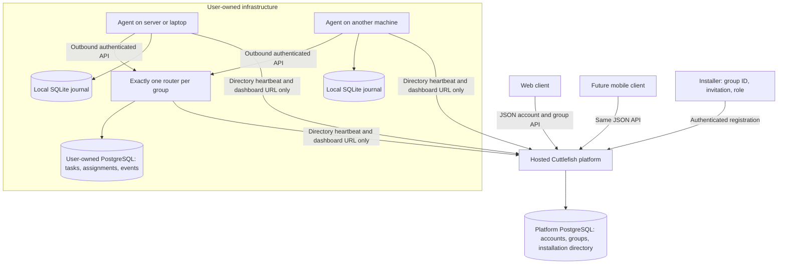

# Hosted registry and user-owned execution

Cuttlefish has three independently deployable roles. Its public website is not
the task router and does not own the user's execution database.

The platform database contains account password hashes, expiring sessions,
account-owned groups, enrollment invitations, and an installation directory.
It never holds provider API keys, task conversations, workspace files, or the
user's PostgreSQL connection string. Users provision and retain their own
execution database. Agents access shared execution state through the router API,
not by receiving direct database credentials.

## Installation choices (registry contract)

1. **Router plus agent**, the default for the first machine. Separate routing and execution components
   run together; sharing a computer does not merge their powers.
2. **Router only**, for a dedicated server. Agents may run on laptops, workstations
   or additional servers and connect outbound.
3. **Agent only**, available after the group has a registered, ready router.

Exactly one registered installation may own a group's router role. A unique
database constraint and a transactional group lock enforce this even when two
installers race. An offline router retains its reservation. Heartbeat loss never
silently promotes another router or replays work. Replacement needs an explicit
ownership-transfer procedure; it is not implied by the installation wizard.

The installer must persist its identity, credential and complete registration request
before making network calls. A retry uses those exact values. Invitations are
single use, group scoped, and expire after thirty minutes. A retry of an already
committed registration is a read of the same registration; a changed request is
rejected. A group ID alone grants no installation authority.

The `cuttlefish setup` command enrolls the installation and starts its local
JSON API and dashboard. Database selection is durably queued in local SQLite;
the service reconciles it independently of the browser connection. Router APIs
become available only after the selected primary is verified and migrated.
See [local installation](local-installation.md) for current provisioning scope.
Registration alone does not mark a machine ready.

## Interfaces

The website is a static client of versioned JSON APIs. A mobile app can use the
same account/group/installation endpoints. Browser sessions use secure,
HTTP-only, same-site cookies; native clients use bearer session credentials.
Installation credentials are distinct from user sessions.

The central directory shows topology, readiness and explicit links to each
installation's router and/or agent dashboard. Those dashboards administer
user-owned services; they do not move execution or secrets into the hosted
platform. A combined installation has both dashboard roles.

Localhost dashboard links are usable only from the machine on which they run.
Remote dashboard access can use Cuttlefish-managed relay access, a user-configured
HTTPS address, or a private tunnel. Registration alone does not expose laptop ports.

## Staging infrastructure

The `Cuttlefish staging` Railway project hosts the platform website/API and its
registry PostgreSQL. This PostgreSQL is not an execution database for installed
agents. User-owned router/agent installations remain separate from this project.

## Managed remote access

The installation runtime supports local-only, existing HTTPS, and managed access.
Managed access uses a separate self-hosted frp relay on Railway, reached by outbound
WSS connectors on users' machines. Installation-scoped grants and address revisions
live in platform PostgreSQL; desired connection state and recovery progress live
in each machine's SQLite journal. See [the implementation and validation](remote-access.md).
No Cloudflare account or purchased domain is required. The installer source includes
this choice; published release availability is tracked in the linked document.
