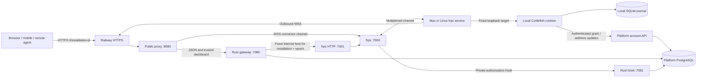

# Cuttlefish-managed remote access

Cuttlefish uses its own relay service with pinned **frp v0.72.0**. End users do
not need a Cloudflare account, domain, router port forwarding, or a public IP.
The installation makes an outbound, certificate-verified WSS connection to the
relay. Railway supplies the relay's public HTTPS certificate.

## Components and storage

Only port 8080 is publicly exposed. The other listeners bind to loopback inside
the relay container. The relay does not route LLM tasks or run agents. Execution
still belongs to the user's router and agents, using the user's own database.

| State | Location |
| --- | --- |
| Installation identity, credential hash, grant revision and epoch | Platform PostgreSQL |
| Connector token signing key | Platform service secret, never on the relay |
| Public verification key | Platform and relay service configuration |
| Desired remote mode, revision, lease, local address and pending progress | Installation SQLite journal |
| Connector credential and frpc configuration | Private installation journal/files |
| Process ownership | launchd on macOS; systemd on Linux |
| Tasks and execution data | Existing user-owned execution database and node journal |

## Installer and local dashboard

During setup choose `local`, `managed`, or an existing HTTPS origin. Complete
first-time administrator setup using the local dashboard and its one-time code.
Managed exposure starts only after this step. The local dashboard's Remote access
settings can change the choice later.

- **Local:** the runtime stays reachable locally. Switching back stops owned
  connector services before trying to revoke the hosted grant. A hosted outage
  cannot keep the connector running through this sequence.
- **Managed:** acquire an installation-specific grant, install the pinned frpc,
  start its OS service, verify the route against a fresh local proof, then publish
  `https://<relay-host>/i/<installation-id>` to the group directory.
- **Existing HTTPS:** stop managed connectors, revoke any previous grant, verify
  the supplied origin, then publish it. The operator supplies the reverse proxy.

A group ID identifies a group; joining still requires a one-use enrollment code.
Remote exposure never makes the group ID an authentication credential. Agents
that only call an already-public router do not need their own inbound relay.

## Authorization and recovery

Each connector uses a credential distinct from installation enrollment and local
administrator sessions. The issuer exchanges it for a five-minute Ed25519 JWT.
frps verifies issuer/audience/signature/expiry. The private Rust hook additionally
checks the active installation grant on login, proxy creation, heartbeat and work
connections. A connector cannot choose another installation's identity, run ID,
proxy name, domain, ports, groups or header rewrites.

Rotating a grant changes its epoch and internal hostname. The public URL remains
stable, but the gateway routes only to the current epoch. Revocation also blocks
new gateway requests immediately; existing requests already in flight can finish.
Heartbeat and work-connection checks prevent old connectors from remaining useful.

Grant/address mutations use monotonic revisions and accept only exact retries.
The local journal saves intent and credential before acquisition, and saves the
lease before starting the service. A restart adopts the same OS-managed connector
rather than spawning a duplicate. Local work does not wait for platform availability;
agents retain their last authenticated router address during directory outages.

The shared relay origin serves only its own trusted dashboard assets. It forwards
allowlisted JSON APIs, parses/reserializes responses, strips unrelated cookies,
and scopes local administrator cookies to one installation path with Secure,
HttpOnly and SameSite=Strict. It does not forward arbitrary installation HTML,
JavaScript, service workers, app previews or database ports.

## Deployment

`deploy/relay/Dockerfile` builds the Rust gateway and installs checksum-pinned frps.
The entrypoint supervises nginx, frps and the gateway as one restartable unit.
Run one relay replica with sleep disabled; multiple replicas need explicit tunnel
ownership and request routing before they are safe.

Platform configuration: `RELAY_ORIGIN`, `RELAY_PUBLIC_KEY` (base64url Ed25519 public
key without padding), `RELAY_PRIVATE_KEY` (PKCS#8 PEM). Relay configuration:
`DATABASE_URL` for the platform registry, `PUBLIC_ORIGIN` for the issuer,
`RELAY_ORIGIN`, and `RELAY_PUBLIC_KEY`. Never use the public test key in deployments.

For Railway, use the dedicated Dockerfile, port 8080, `/healthz`, one replica and
sleep disabled. New services reject legacy railway.toml configuration paths;
configure those service settings through Railway's current service API or IaC.
The existing platform service still uses its legacy configuration until migration.

Current limits: 128 concurrent gateway requests, 1 MiB request/response bodies,
20-second upstream timeout, 1 MB/s per proxy. The gateway supports the current
JSON/polling APIs. The underlying transport supports SSE/WebSockets, but exposing
additional streaming application protocols through the public gateway is later work.
Windows managed connectors and horizontal relay scaling are also deferred.

## Verification

- `cargo coverage --features cuttlefish-machine/docker-tests --locked` retains
  the 100% line/function/region requirement across all workspace source.
- `experiments/relay/container_smoke.py` checks non-root nginx configuration and
  bounded child-failure cleanup in the relay container.
- `experiments/relay/service_smoke.py` checks Mac/Linux service-manager commands,
  retry idempotence, owned-service withdrawal and unavailable-manager failures.
- `experiments/relay/authorization_smoke.py` runs real frp against disposable Rust
  issuer/gateway services: authorization, routing, connector/server/gateway
  restarts and immediate revocation.
- `experiments/relay/mac_staging_smoke.py` exercises a disposable native Mac
  installation against explicitly supplied staging endpoints, including local
  supervisor and optional Railway relay restart recovery.
- `experiments/relay/transport_smoke.py` separately checks WSS certificate
  validation, routing, streaming and transport recovery against a local TLS edge.

Coverage is not a claim that every network or security failure has been tested.
frp is an external dependency; the real-transport tests cover that integration.

## References

- [frp v0.72.0](https://github.com/fatedier/frp/releases/tag/v0.72.0)
- [frp server plugins](https://gofrp.org/en/docs/features/common/server-plugin/)
- [frp TLS implementation](https://github.com/fatedier/frp/blob/v0.72.0/pkg/transport/tls.go)
- [nginx WebSocket proxying](https://nginx.org/en/docs/http/websocket.html)
- [Railway networking limits](https://docs.railway.com/networking/public-networking/specs-and-limits)

## Staging verification record — 2026-11-07

The full workspace passed **324 tests** with **100% of 7,080 lines, 903 functions,
and 11,191 regions covered**. Clippy, documentation generation and documentation
tests passed. No source exclusion or coverage threshold was relaxed.

Platform: `https://platform-production-105c.up.railway.app`.
Relay: `https://relay-production-f926.up.railway.app`.
The live native Mac test verified managed setup, public HTTPS JSON access,
administrator login with an installation-scoped secure cookie, blocked remote
bootstrap, the same connector PID surviving supervisor restart, reconnection
after a Railway relay restart, and local-only withdrawal surviving another
supervisor restart. Disposable native connector services were removed afterwards.

`v0.2.0-alpha.2` is the first installation release with managed relay support.
The earlier `v0.2.0-alpha.1` binaries do not contain the new setup choice.
The public installer test uses an isolated directory and a real terminal to
exercise `curl | sh`, interactive managed setup, repeat installation and recovery.

Verified deployments in the Cuttlefish staging project:
platform `a71eb9dd-2be7-4566-96af-f6856ee0092e`;
relay `7040a27a-6bf5-4450-a330-3670491332df`. Both reached `SUCCESS`
and returned healthy responses after the final native Mac recovery test.
