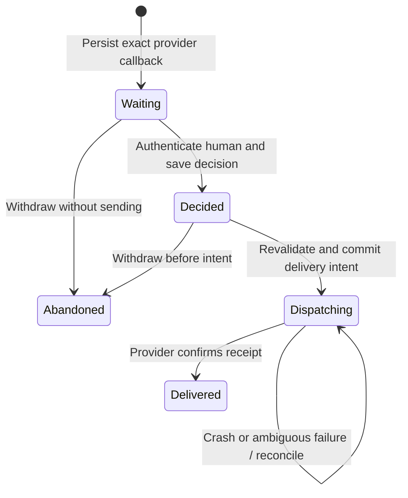

# Durable runtime permissions

This increment implements the execution contract recommended by the Octop review.
It does not install a real coding provider. Production workers still run the fake
specialist. Provider adapters can use the new contract without making the router
responsible for execution or human approval.

## Identities and authority

- `ProviderBinding` immutably maps a group, node, task, Cuttlefish session and
  execution epoch to one configured provider and opaque provider session ID.
  The provider ID is separate from a user's thread. One provider session cannot
  be bound to two local execution sessions.
- `PermissionRequest` adds a unique permission ID, command ID, provider callback
  ID, exact action text and an expiration timestamp. Adapters must include the
  tool, arguments and relevant resource scope in that action. Unreviewed changes
  require a new permission request, never a modified approved record.
- A SHA-256 digest covers every request field using a versioned, length-prefixed
  encoding. This is a scope digest, not a digital signature.
- `PermissionReview` records an immutable decision ID, choice, authenticated
  reviewer ID and journal-generated time. Duplicate identical decisions return
  the saved record; conflicting choices, reviewers or payloads fail.

Reviewers use separately enrolled 256-bit random bearer credentials. The journal
stores only domain-separated hashes. A node transport token has no review powers
unless an operator incorrectly reuses it as a reviewer credential. Keep reviewer
tokens outside agent-accessible workspaces and model context. Tokens are supplied
through files, not command-line arguments.

The local operator and runtime code are trusted: they can write the SQLite file
and configure reviewers. These checks do not sandbox a malicious process with
the same filesystem rights. Central identity/SSO and process isolation are future
work; no self-asserted actor from an LLM is accepted as human approval.

## Durable lifecycle



All transitions use SQLite write transactions. The request, decision and provider
binding survive supervisor replacement. A permission is separate from the
command receipt: the command remains executing or uncertain, cannot be claimed
again, and cannot complete while any permission is unresolved. `Delivered` means
only that a decision reached the provider; it does not mean the task succeeded.

Before delivery, the runtime checks the active original worker, command and
execution scope, immutable provider binding, exact digest, unexpired deadline,
and that the reviewer is still enabled. Expiry is exclusive: a deadline at or
before the journal clock is invalid. A decision expiring after human review is
rejected at delivery. Revocation cannot retract a reply already sent.

Expired requests stay visible. The owning adapter can abandon an unsent request
and issue a fresh request for the same callback with a new permission identity.
That request requires a fresh decision identity and approval. Abandonment sends
nothing and grants no tool authority. An attempted delivery cannot be abandoned.

## Provider adapter integration

1. Persist `Journal::bind_provider` for a claimed command before any effectful
   operation in that provider session. The provider's initial session-creation
   idempotency/reconciliation strategy is the real adapter's responsibility.
2. On a tool callback, call `Journal::request_permission` before waiting. Preserve
   the exact provider callback and action. Continue worker heartbeats while waiting.
3. Surface `pending_permissions` and `permission` to the human review channel.
   A model can request approval; it cannot call the reviewer path with authority.
4. Implement `PermissionProvider::reconnect` as a read-only attachment to the
   original session. Return its actual binding; a different session is rejected.
   It must never silently start a new session or execute a command.
5. Call `provider::deliver_permission`. It persists `Dispatching` **before**
   invoking `PermissionProvider::respond`. Forward the exact saved choice, scope
   and callback. A denial must not be translated into an allowance. Enforce the
   reviewed scope at the actual tool execution boundary.
6. A positive provider acknowledgment is persisted separately. The original
   command needs its own real result before `Journal::complete` can finish it.

| Operation / recovery state | Retry policy |
| --- | --- |
| Identical binding, request, human decision or inspection | Idempotent; returns saved state |
| Read-only reconnect fails | May retry; no reply has been sent |
| Waiting after restart | Display the same request; do not contact the provider yet |
| Decided after restart | Reconnect to the same resumable session; revalidate before sending |
| Provider does not support reconnect | `NeedsReconciliation`; never create a replacement session |
| Dispatching after restart or failed response | `NeedsReconciliation`; no automatic second reply |
| Provider accepted reply but local acknowledgment failed | Remains dispatching; no automatic replay |
| Delivered | Return the existing result without reconnecting or responding |
| Abandoned | No reply; fresh request and approval needed for an effect |

Explicit provider evidence may be recorded with `acknowledge_permission` by the
owning runtime. There is deliberately no “force retry” or “mark success” operator
command. If the provider cannot establish whether it accepted a reply, leave it
unresolved. The contract favors avoiding duplicate effects over automatic progress.

## Local review commands

The state directory must already contain a migrated node journal. Generate a
separate random 32-byte credential and store its 64 lowercase hexadecimal
characters in a protected file (optional trailing newline). Never reuse a node
token or put the reviewer credential in a prompt.

```sh
# Trusted operator: enroll a human; same command rotates their credential.
cargo run -p orchestrator-node -- permissions --state-dir ./node-state reviewer \
  --reviewer <reviewer-uuid> --token-file ./private/reviewer-token

# Inspect requests; each response contains exact action, digest and saved review.
cargo run -p orchestrator-node -- permissions --state-dir ./node-state pending
cargo run -p orchestrator-node -- permissions --state-dir ./node-state inspect \
  --permission <permission-uuid>

# Human: approve exactly the inspected digest. Omit --allow to deny.
cargo run -p orchestrator-node -- permissions --state-dir ./node-state decide \
  --permission <permission-uuid> --decision <new-decision-uuid> \
  --digest <inspected-sha256> --token-file ./private/reviewer-token --allow

# Trusted operator: revoke the reviewer's authority, including unsent approvals.
cargo run -p orchestrator-node -- permissions --state-dir ./node-state reviewer \
  --reviewer <reviewer-uuid> --token-file ./private/reviewer-token --disabled
```

`pending` returns at most 32 records ordered by permission ID. Pass `--after` with
the last ID to read the next page; restart pagination to discover newly arriving
requests. Inspection is local-operator access, not a network endpoint.

## Storage and boundaries

Migration `0004_runtime_permissions.sql` adds provider bindings, hashed reviewer
credentials and durable permission records to each node's SQLite database.
Shared assignments remain in PostgreSQL. This increment does not add remote
permission endpoints or copy sensitive action text into router context. The
router continues to see a dispatched command as outstanding; it cannot reroute a
claimed command merely because that command is awaiting permission.

Next integration: a real provider adapter, provider-side evidence reconciliation,
and authenticated permission-event synchronization with a human review service.
Tests here prove local durability and the fake provider contract, not that an
external provider supports reconnect, cancellation or exactly-once side effects.
